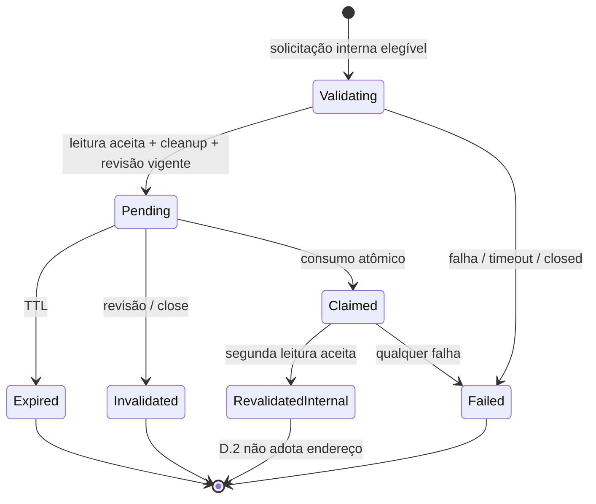

# F2E.D.2 — auditoria de validação read-only e desenho para revisão

**Data:** 2026-10-18. **Estado:** investigação e proposta; implementação não autorizada nesta execução. Base local `origin/develop` = `c2d79f3`, integração da PR #33; branch `feature/f2e-d2-validation`. Nenhum validador, token, barreira ou operação pública foi implementado.

## 1. Escopo e autoridade das decisões

[D-018 e D-019](DECISIONS.md) continuam sendo as decisões aprovadas. O [desenho D.0](F2E_D_RECOVERY_ARCHITECTURE.md) orienta o fluxo; seus trechos históricos que chamam os defaults de pendentes devem ser lidos junto à aprovação posterior D-019. Este documento não altera essas decisões nem aprova as escolhas adicionais abaixo.

A intenção é preparar recuperação manual: uma leitura aceita sob a chave cadastrada fornece evidência limitada de participação em uma troca autenticada. Não comprova identidade criptográfica independente, exclusividade da chave, nem que o host que encaminha a conexão armazena pessoalmente a chave. Relay/proxy para outro endpoint autenticado continua possível. Chaves compartilhadas, reaproveitadas ou vazadas e troca de endpoint após a leitura permanecem riscos. O risco de relay e os detalhes deste desenho precisam ser explicitamente considerados na revisão, sem ampliar o aceite para recuperação automática.

D.2 deverá produzir apenas propostas internas após validação. D.3 continua responsável pela confirmação pública, aplicação do endereço em memória, resultado `ADOPTED`, readback separado e JSONL. Não há autorização de TOML, adoção 3.3, cloud, descoberta automática ou testes físicos.

## 2. Proveniência e método da auditoria

- Python local 3.14.3; metadados instalados: TinyTuya **1.20.0**, backend criptográfico selecionado `pyca/cryptography`, com suporte GCM. `backend/pyproject.toml` declara **`tinytuya>=1.20,<2`**; TinyTuya declara `requests`, `colorama`, `cryptography` e licença MIT. A presença de requests não implica uso de Cloud neste caminho.
- Inspeção estática dos fontes instalados e comparação dos três arquivos críticos com a tag pública `v1.20.0`, resolvida para commit **`8512d8364a9d0e351bbec2597bafa17595545b13`**. Bytes coincidiram com o commit imutável e com os hashes do `RECORD` instalado. Uma primeira visualização web da tag estava desatualizada; não foi usada como autoridade para as conclusões.
- Não foram criados objetos de dispositivo TinyTuya, sockets de descoberta/controle LAN ou tentativas de autenticação de dispositivos. A única consulta externa foi a fontes públicos do GitHub. Não foram lidos TOMLs pessoais, arquivos de devices, credenciais ou cloud. A matriz de testes abaixo é proposta, não execução já realizada.
- Uma versão auditada não comprova toda a faixa `<2`. Não houve alteração de dependências. Proposta: manter a faixa declarada, mas habilitar o adapter de validação apenas para versões incluídas numa matriz explícita de compatibilidade, inicialmente 1.20.0 com estes caminhos e fixtures. Versão não auditada retorna `DEPENDENCY_UNSUPPORTED` antes de I/O. Fixar a distribuição/lock é alternativa que exige decisão do mantenedor.

| Fonte crítica | SHA-256 observado |
| --- | --- |
| `core/XenonDevice.py` | `cd3a5f333eed39c55dafd821a01810ac824c74e6cbd330c9b863e43bf4b7963f` |
| `core/message_helper.py` | `158c14953482071f8e60250b36c208b5e381640a5e8629d1d076d91bcf737283` |
| `core/crypto_helper.py` | `4d5270756da06a55427e44bc838bca5a18ba382d969fa7eb7aecddb446c0903c` |

Referências versionadas: [XenonDevice](https://github.com/jasonacox/tinytuya/blob/8512d8364a9d0e351bbec2597bafa17595545b13/tinytuya/core/XenonDevice.py), [message_helper](https://github.com/jasonacox/tinytuya/blob/8512d8364a9d0e351bbec2597bafa17595545b13/tinytuya/core/message_helper.py), [crypto_helper](https://github.com/jasonacox/tinytuya/blob/8512d8364a9d0e351bbec2597bafa17595545b13/tinytuya/core/crypto_helper.py), [core](https://github.com/jasonacox/tinytuya/blob/8512d8364a9d0e351bbec2597bafa17595545b13/tinytuya/core/core.py), [const](https://github.com/jasonacox/tinytuya/blob/8512d8364a9d0e351bbec2597bafa17595545b13/tinytuya/core/const.py). Intervalos abaixo usam numeração de linhas desses fontes; não se deve consultar `master` para reproduzir a auditoria.

## 3. Autenticação: fatos observados e condições de aceite

| Evidência no código | Conclusão e efeito no desenho |
| --- | --- |
| `XenonDevice:350–430`, `893–950` | `_get_socket()` conecta e negocia sessão para versões >=3.4. Step 1 restaura a Local Key e gera nonce de 16 bytes com `os.urandom`; step 2 exige comando de resposta e pelo menos 48 bytes, verifica HMAC-SHA256 do nonce local; step 3 envia HMAC do nonce remoto. Isso depende da chave, não de igualdade criptográfica com Device ID. |
| `XenonDevice:952–969`, `972–996` | A chave de sessão deriva do XOR dos nonces; em 3.5 usa AES-GCM com a Local Key e IV derivado do nonce local. Os frames transmitidos usam prefixo `6699` e a chave corrente. Não exportar Local Key, chave de sessão ou nonces como evidência. |
| `message_helper:155–176`; `crypto_helper:105–124`, `142–161` | GCM recebe tag e header como dados autenticados; o backend criptográfico verifica a tag. Falha gera `crc_good=False`; unpack por si só não é um gate de aceitação. |
| `XenonDevice:458–510` | `_receive()` procura tanto `55AA` quanto `6699`. Rejeita explicitamente tag inválida **somente para `6699`**. Para `55AA`, `message_helper:139–154` apenas calcula/retorna `crc_good`; o chamador não exige True. |
| `XenonDevice:778–872` | No modo 3.5, o decoder pode interpretar JSON sem outra descriptografia. Portanto um frame `55AA` com HMAC inválido e JSON plausível pode atravessar esse caminho se recebido durante uma sessão. A combinação das duas rotinas impede usar o simples retorno de `status()` como evidência de integridade de cada resposta. É uma conclusão de fluxo estático, não uma tentativa de exploração em rede. |
| `XenonDevice:893–900`, `513–550` | A negociação ignora o resultado do envio do step 3 antes de finalizar a chave local. Um handshake aparentemente finalizado não basta: é necessária resposta posterior válida sob a chave de sessão. `_send_receive_quick` também absorve exceções de recepção. |
| `XenonDevice:1034–1044`, `1069–1087`, payloads `v3.5` | `status()` envia DP_QUERY, mapeado para DP_QUERY_NEW. A consulta 3.5 não inclui Device ID. `_get_retcode` apenas registra código quando o comando corresponde; não recusa todo comando divergente. Em 3.5 a sequência de resposta não precisa repetir a enviada. Não exigir igualdade ingênua de seqno nem inferir correlação estrita do JSON final. |
| `XenonDevice:298–336`, `350–385` | Chave vazia pode consultar `device_info()`/devices.json. Endereço vazio, `Auto` ou `0.0.0.0` dispara descoberta; modo auto pode redescobrir depois de falha. Versão 3.2 pode detectar DPS via `set_version`; subclasses podem fazer I/O no construtor/set_version. Validar parâmetros antes de qualquer factory e usar somente o caminho 3.5 explícito. |

**Aceite proposto:** sessão nova, sem reuso de cache/socket; chave interna não vazia e codificável em exatamente 16 bytes; protocolo cadastrado 3.5; candidato único F2E.B com `announced_versions == ("3.5",)`; resposta de negociação e resposta DPS em `6699`, com tag válida sob a chave correta de cada fase, HMAC de desafio válido e envio do finish bem-sucedido. Depois, uma resposta read-only da sessão corrente com comando permitido, retcode de sucesso, JSON estrito, DPS estruturados e pelo menos um campo mapeado semanticamente reconhecido. Sem esse conjunto, nenhuma proposta.

Uma resposta 3.5 de status válida demonstra participação numa troca sob a chave cadastrada e a chave derivada naquela sessão. Não prova identidade independente nem exclusividade da Local Key. Não usar anúncio, HMAC do UDP, status em cache, `None`/ACK, um dicionário `dps`, `Err=914` ou ausência de exceção como substituto dessa evidência.

O código 914 é ambíguo: chave malformada, negociação sem resposta suficiente ou HMAC inválido podem chegar nele. Timeout em `_get_socket()` pode virar erro offline; GCM inválido pode virar 904/None após retries. O adapter atual normaliza códigos, mas perde a fase/causa necessária à classificação precisa da D.2. Não rotular todo 914 como prova de chave incorreta, nem todo 904 como autenticação recusada.

## 4. Timeout, retries, lifecycle e logs

### O timeout atual não é um deadline de operação

Em `TuyaAdapter.__init__`, o projeto passa timeout cadastrado, `connection_retry_limit=1`, delay zero e `persist=False`. Os testes verificam esses argumentos, não o comportamento interno completo do TinyTuya.

- `_get_socket:359–424` limita tentativas de conexão por aquela invocação. `_send_receive:634–689` usa `retries > socketRetryLimit`: limite 1 ainda permite uma nova tentativa após a inicial, incluindo reconexão/handshake, e sleep de 0,1 s. `set_retry(False)` afeta `max_recv_retries`, não elimina essa lógica de reenvio. Limite zero não é solução: `_get_socket` não tenta conectar.
- `_negotiate_session_key:894` usa até duas recepções no quick path, independentemente do limite configurado para envio normal. `_send_receive:606–607` também usa `sendWait` (default 0,01 s); há waits de recepção/ACK. `status:1078–1083` contém caminho de nova consulta após ERR_DEVTYPE; a detecção automática observada em `_decode_payload:825` limita-se a 3.3/3.4, mas não se deve habilitar fallback no validador 3.5.
- `socket.settimeout(connection_timeout)` limita uma operação bloqueante, não a soma. `_recv_all:438–456` aceita fragmentos sucessivos; `_receive:476–493` busca prefixos em loop. Tráfego lento ou lixo contínuo pode prolongar a chamada sem um deadline monotônico, mesmo com tamanho máximo de payload (`const.MAX_PAYLOAD_LENGTH=1440`).
- Exemplo de extrapolação: connect consumindo quase 2,5 s e recepção de negociação consumindo mais de 2,5 s no agregado já excedem o teto proposto, antes de status. Não existe limite total de 2,5 s demonstrável apenas pelos parâmetros atuais. Dois status de validação mais readback e UDP permitem **10,5 s** antes de overhead; **9 s continua meta**, não garantia.

### `persist=False` não é garantia universal de cleanup

`_check_socket_close:432–436` fecha em vários retornos normais/erros, e `_process_message:768–775` fecha antes de retornar o resultado. Porém não há um único `finally` envolvendo todos os caminhos: setup de socket/settimeout está fora de parte dos catches; interrupções propagam; fechamento pode lançar. `close:1208–1217` captura qualquer falha e zera a referência, sem informar se o fechamento foi bem-sucedido. `__del__` não dá prazo determinístico. O `TuyaAdapter` atual nem expõe `close()`.

Uma factory que aloca e lança antes de devolver o objeto precisa limpar seus próprios recursos. O chamador não consegue fechar um objeto que nunca recebeu. Proposta: factory pura sem I/O; socket só criado dentro da operação, registrado imediatamente num owner/contexto com `finally`. Cleanup é idempotente, checado e obrigatório antes de sucesso; falha/expiração no cleanup invalida o resultado, mesmo após DPS válido. Nenhum timeout de Future deve abandonar uma thread executando TinyTuya.

`socket.close()` não oferece timeout próprio e a biblioteca suprime sua falha. O caminho proposto não habilita SO_LINGER e não depende de shutdown bloqueante; ainda assim uma garantia rígida contra travamento nativo/OS não foi comprovada. Se isso for requisito absoluto, será necessário outro desenho com isolamento em processo e política de término/join, não uma thread destacada. Esse requisito permanece pendente.

### Logs são parte da segurança criptográfica

`XenonDevice:347–348` inclui chave no repr; `933–968` registra nonces/chave de sessão em DEBUG; `1085` registra a chave corrente; recepção/decodificação registra bytes e DPS. Além disso, **`crypto_helper:49–64` escolhe IV fixo quando `iv=True` e DEBUG está habilitado**. Silenciar somente handlers/filtros não muda `isEnabledFor(DEBUG)` nem corrige o IV. `set_debug(False)` em `core:151–152` põe NOTSET em um logger; não garante silêncio dos filhos com root DEBUG.

No adapter proposto, não instanciar XenonDevice, não usar seu repr/status/decoder/cache e não chamar `set_debug`. Fornecer IV aleatório explícito de 12 bytes a cada frame; assim o branch `iv=True` nunca decide a segurança. Validar prefixo/tamanho antes do helper e aceitar somente GCM válido. Não encaminhar mensagem/traceback da biblioteca; logs próprios só enumeram fase e categoria. Os caminhos low-level efetivamente usados precisam passar teste com root DEBUG e loggers TinyTuya DEBUG, inclusive falhas criptográficas. Caso qualquer helper usado registre material sensível, não liberar D.2.A sem isolamento/ajuste do caminho ou política permanente de logging revisada; proibir toggles globais temporários concorrentes. A exposição DEBUG do adapter normal já existente é um risco separado a ser tratado explicitamente, não uma proteção que o desenho presume existir.

## 5. Abordagens e recomendação pendente

| Abordagem | Avaliação |
| --- | --- |
| Reutilizar `TuyaAdapter.read_status()` como prova | Rejeitada: não entrega evidência de frame/handshake, normaliza causas diferentes, não tem deadline total nem cleanup observável. Um wrapper com Future timeout deixa execução ativa. |
| Subclasse de TinyTuya Device com overrides | Possível, mas exige controlar `_get_socket`, `_receive`, `_send_receive`, negociação, logs e cleanup. Forte acoplamento a métodos privados e loops duplicados; monkeypatch global de socket/log não é aceitável com dispositivos concorrentes. |
| **Adapter dedicado 3.5 usando helpers de frame/crypto** | **Recomendado para aprovação**: transporte síncrono próprio pequeno, fases explícitas, nenhuma API de escrita, reuso de `pack_message`, `unpack_message`, `parse_header`, `AESCipher` e constantes auditadas. Evita retries/fallbacks/cache de Device. Custo: manter um cliente read-only estreito e sua matriz de compatibilidade; não copiar grandes trechos nem criar fork da biblioteca. |

A recomendação exige ajuste consciente do aceite D.0 que menciona literalmente chamada `status()`: cumprir a consulta read-only de DPS no wire, em vez de exigir invocação do método TinyTuya. Isso é **proposta**, não mudança já aprovada do documento normativo. Preservar licença MIT, atribuição e referência da dependência; eventual código adaptado deve manter aviso correspondente, sem vendorização grande.

## 6. Interfaces e responsabilidades propostas

Nomes abaixo são contratos de desenho, ainda inexistentes. Nenhum DTO público ou JSONL é acrescentado.

| Módulo/componente | Interface proposta e responsabilidade |
| --- | --- |
| `recovery_validation.py` | `CandidateValidator.validate(snapshot, candidate, *, deadline, cancellation) -> ValidationResult`. Factory de adapter, clock e cancelamento injetados. Confere elegibilidade, faz uma consulta autenticada, aplica parser semântico puro, fecha recurso e só então retorna evidência reduzida. |
| `tuya35_readonly.py` | `ReadOnlyAdapterFactory.create(private_config, candidate_address) -> ReadOnlyAdapter`; `read_authenticated_dps(*, deadline, cancellation) -> PrivateAuthenticatedRead`; `close() -> CleanupOutcome`. Factory não conecta. Transporte/socket factory e gerador de entropia injetáveis. Não há `set_value`, escrita DPS, auto discovery, child/gateway ou hostname. |
| `dps_observation.py` | Extrair a interpretação pura hoje embutida em `DeviceManager._read_state_unlocked` (power bool, work_mode/scene string, ranges numéricos finitos, HSV existente). Manager mantém aplicação a estado/pending; validator usa somente interpretação temporária, sem mutar caches. Exigir pelo menos um campo reconhecido. |
| `device_manager.py` | `recovery_snapshot(device_id, *, deadline, cancellation) -> PrivateConfigSnapshot`; `recovery_transaction(device_id, expected_revision, *, deadline, cancellation) -> PrivateDeviceLease` como context manager interno. Snapshot imutável com revisão; lease detém um único lock e fornece somente configuração/revisão internas. Não expor por protocolo. |
| `recovery_proposals.py` | `create_validated(binding: ProposalBinding, evidence: AcceptedRead, *, now) -> ProposalDescriptor`; `claim(token, *, now) -> ClaimResult`; `invalidate_older(device_id, revision) -> None`; `close() -> None`. Clock e geração de token injetáveis; tabela limitada, sem timer/worker. Não persiste nem conhece sockets/chaves. |
| `recovery.py` / coordenador | `prepare_internal(device_id) -> PreparationResult`, com composição do classificador D.1, slot global, snapshot, fila e store. Resultado de sucesso interno contém descritor de proposta; `discover_for_recovery` continua exclusivamente D.1. |
| `command_scheduler.py` | `submit_recovery_validation(request: RecoveryValidationRequest) -> Future[PreparationResult]`; item discreto `VALIDATE_RECOVERY`, payload fechado e handler backend fixo. Mecanismo interno de revalidação usa o mesmo turno/exclusão, sem endpoint confirmável. |

`PrivateConfigSnapshot` carrega a configuração já em memória, revisão e endereço original somente no backend; impedir repr/serialização do snapshot, não apenas esconder um campo em `DeviceConfig`. Configuração e chave não ficam na fila, proposta, resultado nem exceção. O request tipado da fila contém apenas ID, candidato, revisão esperada, deadline e sinal de cancelamento internos.

`PrivateAuthenticatedRead` contém transitoriamente DPS e evidência interna obtida do transporte estrito, nunca um booleano oriundo do cliente. Ele não atravessa o validator. O `ValidationResult` reduzido é fechado: `KEY_AUTHENTICATED_READ`, `PROTOCOL_NOT_ELIGIBLE`, `TIMEOUT`, `TRANSPORT_FAILED`, `AUTH_FAILED`, `INVALID_RESPONSE`, `CLOSED`, `CLEANUP_FAILED`, `DEPENDENCY_UNSUPPORTED`, `INTERNAL_ERROR`. Pode incluir fase enum (`CONNECT`, `HANDSHAKE`, `STATUS`, `CLEANUP`); não inclui DPS, chave, MAC, nonce, bytes, config, token ou exceção original. A evidência de sucesso não se chama identidade verificada. Erro inesperado da factory/handler é INTERNAL_ERROR; o novo handler normaliza exceções antes de completar a Future, pois o scheduler atual encaminha exceções de `_execute` à Future.

Timeout usa clock/deadline, transporte usa falha de socket estruturada, autenticação usa falha explícita de tag/HMAC e resposta inválida usa formato/comando/DPS. Handshake encerrado pelo peer sem prova de erro criptográfico é transporte/resposta inválida, não diagnóstico de chave incorreta. Cancelamento observado retorna CLOSED e impede publicação tardia. Cleanup falho bloqueia sucesso; preservar a causa primária somente como enums internos, nunca mascarar falha como resultado aceito.

`PreparationResult` preserva os resultados de ausência, ambiguidade e falha do classificador D.1 e acrescenta `CONFIG_CHANGED`, `CLOSED`, `BUSY`, falha tipada de validação e `PROPOSAL_READY_INTERNAL`. Somente o último contém `ProposalDescriptor` (token redigido no repr, ID, IPv4 e expiração monotônica internos); nenhum caso contém estado físico. `ClaimResult` distingue claim interno único de indisponibilidade, e não é uma autorização de adoção. Uma solicitação tipada de revalidação carrega o claim interno consumido; seu resultado é apenas `ValidationResult` e não cria outra proposta/token nem estende TTL. Nenhum desses novos nomes altera o DTO D.1 ou os envelopes JSONL atuais.

Semântica mínima mantém a política existente: no manager, work_mode e scene são reconhecidos pelo tipo string, sem catálogo de valores; não vender isso como validação forte de modelo. JSON com `invalid_json`, duplicação de chaves normalizadas ou números não finitos deve ser rejeitado pelo caminho de validação. Endurecimento além dos parsers atuais deve ficar explícito nos testes; não mudar silenciosamente como o controle normal interpreta dispositivos já homologados.

### Transporte estrito proposto

1. Preflight sem I/O: versão auditada/GCM, cadastro 3.5, ID candidato exato, uma claim 3.5, IPv4 unicast utilizável segundo F2E.B, chave interna com 16 bytes Latin-1. Recusar `Auto`, endereço ausente/especial e qualquer opção de discovery/fallback. Porta fixa LAN 6668; nenhum caminho DNS, arquivo, gateway ou Cloud.
2. Conectar uma vez; nonce local novo; enviar start, verificar resposta GCM sob Local Key e HMAC com comparação constante; enviar finish e confirmar sucesso do envio; derivar chave de sessão.
3. Enviar uma DP_QUERY_NEW read-only, receber resposta autenticada sob a sessão; não repetir envio nem reconectar. ACK vazio pode ser consumido dentro dos mesmos limites. Proposta de allowlist de resposta: STATUS/DP_QUERY_NEW com retcode zero; compatibilidade por firmware e tratamento de sequência global 3.5 são gates de fixtures e futura homologação, não fatos provados por hardware.
4. Rejeitar `55AA` independentemente de HMAC; rejeitar qualquer tag/HMAC inválido, fase/comando inesperado, resposta cached, JSON inválido ou ausência de campo reconhecido. Nenhuma fallback para 3.3.
5. Fechar em `finally`, descartar referências a buffers/chaves. Python não garante apagamento físico de strings/bytes imutáveis da memória; a garantia é ausência de persistência/exposição e redução do tempo de retenção, não zeroização criptográfica.

Propostas adicionais para revisão: até **8 frames recebidos e 12 KiB totais por leitura**, payload individual no máximo **1440 bytes** (limite existente do helper); sem busca ilimitada de prefixos. Um único socket de validação por processo. Limites incluem ACKs e handshake; saturação é falha, nunca resposta parcial. São margens conservadoras para quadros pequenos de iluminação, sem validação REAL de todos os firmwares.

## 7. Orçamento e encerramento

Proposta de aplicação de D-019: `prepare_deadline = início + 5,5 s` (3 s UDP + 2,5 s validação/coordenação), limitado também pelo chamador. Snapshot inicial e espera pela FIFO consomem esse orçamento; não ganham prazo ilimitado. UDP recebe no máximo 3 s e o saldo. Após scan, deadline da etapa é `min(prepare_deadline, agora + 2,5 s, agora + timeout_cadastrado)` **antes** de enfileirar; espera na fila/lock, factory, TCP e cleanup consomem esse mesmo saldo. Se a fila consumir a janela, não abrir socket. Para revalidação, mesma janela de até 2,5 s sem novo UDP. Esses detalhes de distribuição ainda precisam de aprovação.

O transporte verifica deadline/cancelamento antes e depois de cada fase, envio, fragmento e parse. Timeout de socket é recalculado com tempo restante; buffers e loops são limitados. Para cancelamento responsivo, propor socket não bloqueante com `select` injetável em fatias de até 100 ms, connect único via connect_ex/SO_ERROR, sem reconnect/retry. Uma espera por readiness ou fragmento na mesma conexão não é uma nova consulta. Não alterar timeout/socket global do Python.

Nenhuma garantia rígida de 2,5 s será declarada antes de demonstrar todos os caminhos com fakes, integração de API/Windows e limites de cleanup/OS. No caminho D.3, o readback normal ainda usa o adapter atual, cujo deadline total não está provado: a soma 10,5 s permanece referência de alocação, não teto do aplicativo. D.2 não inclui readback.

`close()` do serviço: marcar fechado e invalidar store sob mutex curto; sinalizar cancelamento da operação; cancelar item ainda enfileirado; aguardar operação iniciada limpar recursos, fora de todos os locks de dados. Depois pode-se parar o scheduler compartilhado na ordem de shutdown da aplicação. Um serviço de recovery não deve desligar o scheduler de iluminação ao fechar sozinho. Workers existentes são reaproveitados; não criar executor permanente adicional nem thread por timeout.

Se o chamador deixa de esperar uma Future em execução, isso não cancela I/O nem libera capacidade: manter o slot até confirmação de cleanup pelo owner. Shutdown retorna `INCOMPLETE` se owner ainda não terminou; não afirmar que fechou, não publicar proposta depois de CLOSED e não liberar outro scan/validação sobre recurso ainda ativo. A capacidade de cancelar UDP é limitada pelo ciclo síncrono atual F2E.C (até sua janela); após retorno, verificar cancelamento antes de TCP. Travamento nativo de cleanup exige escalonamento de arquitetura, não abandonar thread.

## 8. Snapshot, locks e barreira FIFO

### Estado real observado

`DeviceManager` usa `threading.Lock` por dispositivo, não RLock. Leitura, escrita e `update_address:177–202` fazem I/O/mudança sob esse lock. `update_address` substitui config, descarta adapter por referência e invalida connection/knowledge; preserva intenções pendentes. Não existe revisão, fechamento explícito do adapter ou snapshot privado versionado. `DeviceConfig.local_key` tem `compare=False`; comparar dataclasses não detecta uma troca só de chave.

`_read_state_unlocked:408–518` altera `_last_read_power`, `_last_read_fields`, pending, quality, knowledge e estado confirmado. Portanto validação não pode chamá-lo, nem `read_state`, nem `_get_adapter_unlocked` (que registra adapter/falhas). Extrair somente interpretação pura; snapshot do estado antes/depois deve permanecer idêntico em sucesso e falha da validação.

O scheduler tem Condition, deque e worker por ID. `_worker` solta Condition antes de `_execute`; `stop` cancela pendências e faz join fora da Condition, podendo retornar False com operação ativa. Hoje `_CommandKind.continuous` significa tudo exceto POWER: adicionar enum de recuperação sem mudar esse predicado o tornaria contínuo indevidamente. Reads JSONL/polling não passam pela FIFO, mas usam o lock do manager; portanto FIFO só é garantida entre itens enfileirados, não entre todas as leituras diretas.

### Proposta de coordenação

- Revisão monotônica por ID inicia em zero e incrementa em toda substituição bem-sucedida de config, inclusive `update_address()` existente, mesmo troca repetida para o mesmo IP. Mutação inválida não incrementa. Key/timeout/mapa/protocolo futuros também precisam incrementar; não comparar/hashing de chave para detectar mudanças. D.2 instrumenta a operação existente, mas recovery D.2 nunca a chama.
- Snapshot inicial é curto e limitado por deadline. UDP acontece sem lock do manager. Após descoberta, enfileirar request tipado com revisão esperada. Ao executar, adquirir lease do ID com deadline, comparar revisão e endereço/protocolo; se mudou, retornar CONFIG_CHANGED antes de TCP. Consultar config atual dentro da lease e manter exclusão até cleanup e publicação da proposta. Não reutilizar snapshot privado durante espera humana.
- A lease é exclusivamente interna e não contém métodos de leitura de estado, escrita ou adoção. Não chamar métodos públicos do manager que readquiram o lock dentro dela. Config atual só é consumida pelo validator enquanto a lease está válida; `finally` solta lock mesmo em interrupção.
- Publicar proposta sob lease + mutex curto do store, após cleanup e checks de revisão/deadline/cancelamento/closed. Esse é o ponto de linearização do prepare. Uma mudança posterior incrementa revisão e invalida entradas antigas via método tipado do store. Nenhum callback arbitrário de cliente.
- `RecoveryOperationGate` único por processo deve abranger snapshot, UDP, fila, validação e publicação, e liberar antes da espera humana. Reusar o mesmo coordenador na D.1 e D.2; não adquirir o atual `_PROCESS_RECOVERY_LOCK` e depois chamar `discover_for_recovery()` (lock não reentrante). Extrair classificador/composição interna sem aquisição duplicada, preservando API e regressões D.1. O lock do scanner continua independente e limitado.
- Item de recuperação é discreto, não coalescível, ready imediatamente; escoa segmentos contínuos anteriores como POWER. Coalescing não atravessa a barreira. Um handler interno fixo conhece o request; o IPC não pode fornecer callable, método, IP ou config. Não chamar `.result()` no worker esperando item da própria fila.
- Não criar fila de recovery adicional: gate admite uma operação no processo. Tempo de espera da única barreira conta no deadline. A fila de iluminação existente não ganha limite global novo neste escopo.

**Ordem de locks:** mutex do gate apenas para admitir/fechar, solto antes de outros locks; Condition apenas enqueue/pop/cancel, solta antes de lease/I/O; lock do dispositivo pode adquirir mutex do store por tempo curto; **store nunca adquire lock do dispositivo**. Claim/consulta no store solta seu mutex antes de enfileirar/adquirir lease. Nenhuma Condition ou mutex do store cobre I/O; nunca adquirir Condition segurando lease. Completar Futures/callbacks somente após liberar lease/store. O slot global é uma reserva de capacidade, não um mutex mantido por todo o I/O.

```mermaid
sequenceDiagram
    participant R as Recovery coordinator
    participant M as DeviceManager
    participant S as Scheduler FIFO por ID
    participant V as Validator temporário
    participant P as ProposalStore
    R->>R: admitir slot global
    R->>M: snapshot/revisão com lock curto
    M-->>R: metadados internos
    R->>R: F2E.C + F2E.B sem lock do dispositivo
    R->>S: VALIDATE_RECOVERY(ID, candidato, revisão, deadline)
    Note over S: pop sob Condition; liberar Condition
    S->>M: adquirir lease; conferir revisão
    M-->>S: config interna da revisão vigente
    S->>V: validar read-only na lease
    V->>V: conectar / negociar / ler / fechar
    V-->>S: evidência reduzida ou falha
    S->>P: publicar somente se válido, vigente e aberto
    P-->>S: descritor interno
    S->>M: liberar lease
    S-->>R: concluir Future fora dos locks
    R->>R: liberar slot global
    Note over R,P: espera humana sem slot, lease ou socket
```

Outro Device ID continua com seu worker/lock; somente outra operação de recovery recebe BUSY. Uma leitura normal do mesmo ID pode disputar o lock antes da barreira (FIFO não cobre reads diretos), mas não se sobrepõe à validação. Revalidação D.3 e aplicação futura devem compartilhar a mesma lease; devolver uma evidência ao chamador e atualizar IP mais tarde reabriria TOCTOU e é proibido pelo desenho.

## 9. Propostas internas e transições

Store em memória, protegido por mutex curto; máximo quatro pendentes e uma por Device ID. Store e gate são compartilhados por todas as instâncias de recovery do processo, fornecidos pela composição backend; criar outra instância não pode contornar capacidade. TTL 60 s monotônicos começa na publicação, depois de validação/cleanup. Proposta de token: 32 bytes de entropia do sistema codificados URL-safe; guardar índice por digest no store, não registrar token/digest em logs. A escolha de tamanho é adicional para aprovação. Entropia injetada só nos testes, colisão deve falhar sem sobrescrever registro existente.

Registro: ID, candidato IPv4, versão 3.5, revisão original, endereço original, created_at/expires_at e evidência reduzida. Sem Local Key, DeviceConfig, nonce, pacote, MAC ou DPS. O token só sai em um descritor **interno** e com repr redigido; nenhuma serialização pública na D.2. Reinício não reaproveita registros.

| Transição | Regra proposta |
| --- | --- |
| Sem proposta → VALIDATING | Admitir slot; remover expiradas; se já existe proposta ativa do ID ou quatro pendentes, BUSY antes de scan/validação. Não descartar proposta válida para tentar outra. |
| VALIDATING → PENDING | Somente leitura aceita, cleanup ok, revisão vigente, serviço aberto e capacidade rechecados sob lock. Gerar token só aqui. |
| PENDING → EXPIRED | `now >= expires_at`; remoção oportunista em create/claim/consulta e close, sem timers. Antes da limpeza, uma entrada expirada nunca é considerada ativa. |
| PENDING → INVALIDATED | Config revisada, encerramento ou cancelamento interno explícito; remover por ID/revisão. Manager pode chamar `invalidate_older` enquanto detém lock do ID, sempre na ordem ID→store. |
| PENDING → CLAIMED | Após admissão do slot, `claim` verifica formato/TTL/estado e retira atomicamente a entrada. O mesmo token não pode ser reclamado novamente. Reservar o ID enquanto claim estiver em voo. |
| CLAIMED → terminal | Checar TTL novamente na lease e após revalidação; revisão/endereço/protocolo/cancelamento também. Sucesso interno ou qualquer falha consome definitivamente; não restaurar token após timeout/auth/falha de fila. Nenhuma transição ADOPTED em D.2. |

Não manter histórico ilimitado de tokens usados: desconhecido, expirado, consumido ou invalidado pode produzir `PROPOSAL_UNAVAILABLE` externamente no futuro; testes distinguem a causa controlada internamente. Se D.3 exigir diagnóstico distinto após exclusão, revisar um tombstone limitado — não acrescentá-lo silenciosamente. Verificação de revisão no uso continua obrigatória mesmo com invalidação proativa.

Shutdown incrementa epoch do serviço e fecha store, invalidando tudo. Um worker que estava validando não publica após close. Snapshot/resultado retornado antes de uma mudança é válido apenas no seu ponto de linearização; um token recebido depois de invalidação não pode ser utilizado. A revalidação preparada na D.2 opera somente por comando backend interno de teste/composição; ela não é uma confirmação pública nem retorna uma autorização reutilizável de adoção. D.3 deverá consumir/revalidar/aplicar dentro do mesmo turno e lease.



## 10. Matriz de testes determinísticos proposta

Fixtures criptográficas usam chave/ID sintéticos e frames construídos independentemente dos asserts. Socket, clock, entropia, select, factory e cancelamento são injetáveis; negar socket real, file open de configurações e Cloud nos testes. Não basta FakeAdapter retornar `authenticated=True`: testar os helpers reais e a máquina de transporte com frames sintéticos. Fakes de status atuais não cobrem autenticidade.

| Caso | Evidência exigida | Incremento |
| --- | --- | --- |
| Chave sintética correta; handshake + GCM + DPS reconhecido | Sucesso reduzido apenas após cleanup; zero estado/pending alterado | A |
| Chave incorreta, HMAC de desafio errado, tag de handshake/status adulterada | AUTH_FAILED, nenhum token; payload nunca é aceito por JSON plausível | A |
| 55AA com HMAC válido ou inválido e DPS plausíveis no modo 3.5 | Recusa incondicional; regressão para risco observado | A |
| Nonce/IV repetidos por factory inválida, replay de sessão anterior | Entropia por sessão/frame; replay não autentica sob sessão nova; fixture não depende de relógio real | A |
| Handshake incompleto, ACK-only, erro no envio do finish | Nenhuma evidência de sucesso; categoria por fase, sem chamar status normal | A |
| JSON inválido, chaves duplicadas, dps vazio/ausente, objetos aninhados, NaN/Infinity, somente DPS desconhecidos | INVALID_RESPONSE; zero proposta | A |
| Power bool, ranges válidos/inválidos, HSV e strings conforme parser existente | Ao menos um campo reconhecido; leitura parcial válida não publica estado | A |
| Cadastro 3.3/claim 3.3, claims contraditórias/ausentes e múltiplos IPs | Regressões D.1; zero TCP; AMBIGUOUS preservado | A/B |
| Connect, handshake, status, fragmentação e cleanup expiram | Deadline absoluto compartilhado; nenhum prazo reiniciado por fragmento/ACK | A |
| Tráfego lixo, 9º frame, excesso de bytes/payload, retorno constante de readiness | Encerramento limitado/fail-closed, sem busy-loop ilimitado | A |
| Transporte tenta reconectar/reenviar ou simula retries do Device | Teste detecta mais de um connect/DP_QUERY; cliente Device/status não integra o caminho escolhido | A |
| Factory lança antes/depois de alocação; close lança; cancelamento/interrupção | Owner limpa cada recurso; falha de cleanup não gera sucesso; contrato de factory sem I/O comprovado | A |
| Chamadas de set_value/CONTROL/CONTROL_NEW/UPDATEDPS, scanner incidental, device_info, arquivo privado | Sentinelas falham; wire allowlist contém só negociação e consulta | A |
| Root/filhos TinyTuya em DEBUG, erros e repr/serialização | Nenhuma chave, DPS, nonce, pacote, MAC, token ou exceção bruta; IV explícito aleatório mesmo em DEBUG | A/B |
| Versão fora da matriz ou crypto sem GCM | DEPENDENCY_UNSUPPORTED antes de I/O; Python 3.12 e 3.14 no CI | A |
| Revisão muda durante UDP/antes da FIFO; mudança apenas de Local Key | CONFIG_CHANGED, sem TCP/proposta; revisão não depende de igualdade de dataclass | B |
| Chamada existente update_address com sucesso/erro/mesmo IP | Incremento/invalidação exatos e todos os testes antigos de estado preservados | B |
| Read/write/polling do mesmo ID durante validação | Sem sobreposição, sem reaquisição do mesmo Lock; Events/barriers, sem sleeps de sincronização | B |
| Segundo ID lê/escreve enquanto primeiro valida | Progresso independente; outra recovery recebe BUSY | B |
| Comandos contínuos antes/depois da barreira e POWER | Ordem FIFO; não coalescer através da barreira; Condition livre durante I/O | B |
| Falha/timeout/cancelamento na fila ou no worker | Futures terminais; slot só liberado quando owner terminou; nenhuma operação tardia após closed | B |
| Limite quatro, duplicata por ID, colisão de token | BUSY/erro seguro sem eviction; factory/token nunca persiste segredo | B |
| TTL imediatamente antes/no instante/depois do vencimento; clock de parede muda | Apenas clock monotônico decide; claim não estende TTL | B |
| Dois claims concorrentes, token consumido/inválido | Uma única transição; revalidação no máximo uma vez por proposta | B |
| Config altera depois de proposta, troca IP A→B→A | Token antigo inválido pela revisão, mesmo endereço final igual | B |
| Shutdown durante UDP, fila, handshake, publicação e revalidação | Sem publicação tardia, store vazio/inválido, cleanup observado, shutdown incompleto sinalizado honestamente | B |
| Snapshot completo antes/depois de prepare/revalidate em sucesso/falha | Address, adapter ativo, LightState, DeviceKnowledge, `_last_read_*`, intenções e quality intactos | A/B |

Regressões de base inspecionadas: `test_recovery.py` (eligibilidade/claims, BUSY e métodos proibidos), `test_discovery.py` (normalização/ambiguidade), `test_lan_discovery.py` (coleta parcial/budget/cleanup), `test_tuya_adapter.py` (factory/erros/formatos), `test_device_manager.py` (pending/update/locks/knowledge) e `test_command_scheduler.py` (coalescing/FIFO/progresso/shutdown). As atuais fixtures de adapter não exercitam handshake/tag reais nem o timeout composto do TinyTuya.

## 11. Entregas incrementais após aprovação

### D.2.A — evidência de leitura e transporte limitado

Entregar interfaces/resultados privados do validator, adapter 3.5 estrito, proteção de logs/IV, deadline/cleanup e parser semântico puro compartilhado. Não conectar ao fluxo público, não emitir tokens, não alterar endereços. Introduzir instrumentação de compatibilidade/fail-closed e fixtures criptográficas sintéticas. Se o compartilhamento do parser modificar comportamento normal, corrigir antes de prosseguir; regressões dos dispositivos homologados devem permanecer iguais.

**Aceite:** matriz A verde; nenhuma instância de TinyTuya Device/status no caminho recomendado; uma conexão/consulta; tags inválidas/55AA rejeitados; zero escrita, zero arquivo privado, zero estado confirmado; erro e cleanup tipados; fakes demonstram deadline cumulativo e ausência de reenvio; logging DEBUG não revela material nem fixa IV. Rodar focados, backend completo, compileall e diff-check; CI Windows Python 3.12/3.14. Descrever limites OS/cleanup e firmware ainda não homologados. Gate antes de B: revisão da evidência criptográfica e do comportamento de timeout.

### D.2.B — coordenação versionada e propostas internas

Depende de A aceita. Entregar revisão/snapshot/lease do DeviceManager, item FIFO tipado e gate global compartilhado com D.1, ProposalStore limitado e `prepare_internal`. Preparar consumo/revalidação internos sem aplicação de IP; nada novo em CLI/JSONL/Tauri/React. Instrumentar todas as mutações existentes de configuração para revisão/invalidação, sem disparar essas mutações pelo recovery.

**Aceite:** matriz B verde; nenhuma proposta antes de validação+cleanup; quatro entradas/uma por ID/60 s/uso único; resultados atrasados rejeitados; nenhuma dupla aquisição do Lock; nenhum mutex de scheduler/store em I/O; outro ID progride; shutdown e Future cancelada não deixam operação independente sem owner; nenhuma confirmação pública, ADOPTED, write DPS, persistência ou adoção. Rodar regressões de A/B/F2B/C/D.1, backend completo, compileall e diff-check nos ambientes suportados.

### Fronteira D.3

D.3 acrescentará confirmação pública por token somente, revalidação e atualização atômica sob a mesma lease, fechamento do adapter antigo, invalidação de knowledge preservando pending, readback normal separado e JSONL allowlisted. O método público `update_address()` nunca será chamado de dentro da lease. O desenho D.2 não habilita cliente a enviar um IP novo nem aceitar uma evidência antiga como autorização de alteração.

## 12. Gates de revisão e limitações restantes

1. Aprovar adapter 3.5 dedicado e reutilização low-level, alterando o aceite literal de `status()` da D.0; alternativa por subclass não selecionada automaticamente.
2. Aprovar política de versões auditadas sem mudar silenciosamente `>=1.20,<2`; definir distribuição reproduzível/CI e tratamento de futuras versões.
3. Aprovar limits adicionais: oito frames/12 KiB/1440 bytes, token de 32 bytes, deadlines de coordenação debitados do prepare de 5,5 s e da janela de 2,5 s. Confirmar que hard deadline contra travamento nativo não é requisito já demonstrado; se for, revisar isolamento em processo.
4. Aprovar allowlist de resposta, política para proposta já pendente (BUSY), consumo definitivo mesmo em falha e diagnóstico unificado de token indisponível. Firmware real e interoperabilidade ainda não comprovados.
5. Revisar risco de relay, escopo da política de logging para o adapter normal e sensibilidade residual das strings work_mode/scene. D-018 não vira prova independente de identidade por causa desses filtros.
6. Revisar lease privada + ordem de locks + handler tipado, em especial que reads diretos têm exclusão, mas não FIFO global. Shutdown não pode alegar sucesso enquanto um owner segue em I/O.
7. Resolver a política de faixa/rota IPv4 antes de habilitar TCP: F2E.B rejeita endereços especiais, mas não comprova que o IP seja de uma sub-rede doméstica diretamente conectada. O IP vem do scanner, nunca da WebView; ainda assim um anúncio forjado pode induzir conexão. Proposta conservadora para revisão: restringir validação a sub-redes IPv4 locais explicitamente elegíveis, com decisão sobre VPNs/redes roteadas; não alterar silenciosamente o contrato F2E.B nem fazer probes externos para decidir rota. A enumeração/critério exatos são gate da implementação, não proteção já existente.

**Ponto de parada:** entregar este desenho para revisão do mantenedor. Não iniciar D.2.A/B, modificar dependências, criar código funcional, token real, barreira, commit, PR, push, merge ou autenticação física nesta execução.
