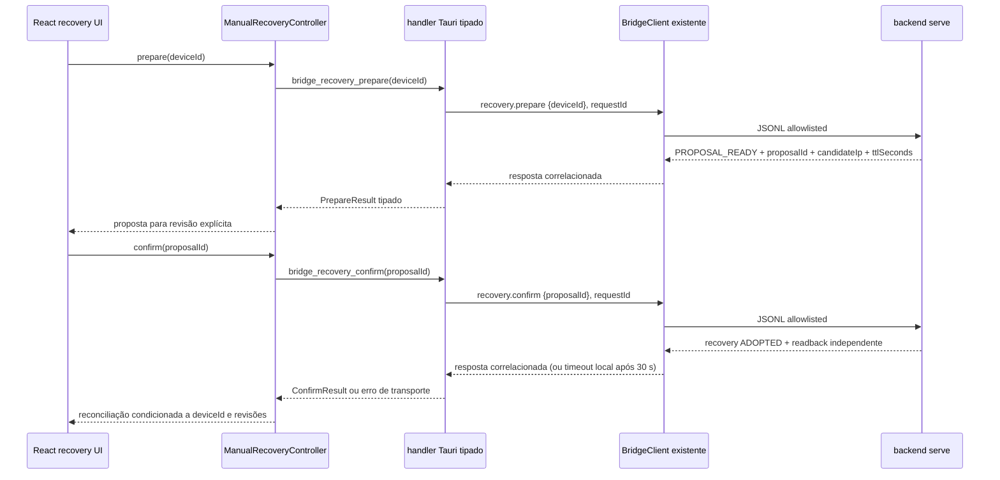
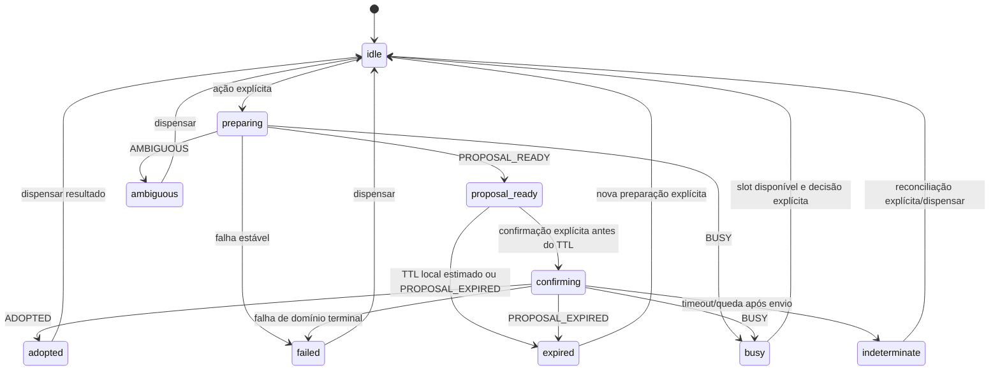

# F2E.D.4.0 — desenho da integração Tauri e UX

**Estado:** auditoria e desenho documental publicado na PR #44; D.4 não está implementada.
**Base auditada:** `origin/develop` após PR #43, merge `e5cdd157dd4d4d3e7934187a454419d421e921bd`. Branch da PR: `feature/f2e-d3b-jsonl`, commit de desenho preexistente `5fe23ce` antes das correções CR-44.
**Limite:** sem handlers, componentes ou lógica funcional; sem acesso a LAN, hardware, Tuya Cloud ou credenciais.

## 1. Como ler este documento

- **Fato atual** descreve o código e os contratos existentes na base auditada.
- **Decisão existente** identifica uma política já aprovada em D-015 a D-019.
- **Recomendação** é uma proposta para as PRs D.4.A–D.4.C, ainda sujeita a aprovação.
- **Pendente** identifica uma escolha ou lacuna que não deve ser resolvida silenciosamente neste desenho.

As decisões D-015 a D-019 continuam normativas. Este documento não as altera. Algumas descrições antigas em `contracts.md`, `architecture.md` e `F2E_D_RECOVERY_ARCHITECTURE.md` antecedem a integração JSONL; a seção 3 registra as correções documentais sugeridas sem reescrever o histórico aprovado.

## 2. Inventário dos contratos reais

### 2.1 JSON Lines: `protocol.py`, `recovery.py`, `recovery_proposals.py`

**Fatos atuais.** `serve` compõe `RecoveryService`, `DeviceManagerRecoveryCatalog` e `TinyTuyaLanDiscoveryProvider`. Construir o provider não inicia descoberta. Somente um pedido válido `recovery.prepare` inicia discovery. Os comandos têm schemas fechados:

| Comando | Payload aceito | Resultado público |
|---|---|---|
| `recovery.prepare` | exatamente `{ "deviceId": string não vazio }` | `{ "status": status }`; no sucesso `{ "status":"PROPOSAL_READY", "proposalId": string, "candidateIp": IPv4, "ttlSeconds": número }` |
| `recovery.confirm` | exatamente `{ "proposalId": string }`, token Base64URL opaco de 43 caracteres | `{ "recovery": { "status": status } }`; após adoção também inclui irmão `readback: { "status": status, "device"?: DeviceStatus }` |

Campos adicionais, IP escolhido pelo cliente, credenciais, DPS e parâmetros de conexão não integram estes schemas. Os comandos são allowlisted; a resposta usa mapeadores explícitos, sem expor exceções, traceback, owner, binding privado, Local Key ou DPS bruto.

Prepare executa `prepare_internal()` fora das threads de stdin e writer, através do executor limitado. Confirm faz o mesmo com `confirm_internal()`. A sessão preserva `requestId`, permite conclusão fora de ordem e mantém um writer único; cada pedido aceito termina uma única vez. EOF fecha o serviço, invalida as propostas daquela instância, sinaliza shutdown e drena operações/executor e respostas aceitas conforme os contratos de lifecycle. O cliente não pode inferir cancelamento por ocultar a janela.

`ProposalStore` usa TTL de 60 s medido por relógio monotônico, token opaco de 32 bytes codificado Base64URL e armazenamento por digest. A proposta é de uso único e vinculada ao owner interno. Expiração, replay e owner não correspondente são intencionalmente indistinguíveis para o cliente (`PROPOSAL_EXPIRED`). Reinício elimina propostas e a adoção em memória; o TOML permanece sem alteração.

### 2.2 Status públicos e erros do transporte

Status públicos são códigos estáveis dentro de `result`, não erros do envelope. A tabela lista os códigos que os mapeadores públicos atuais emitem; caminhos entre parênteses descrevem condições, não criam novos códigos.

| Operação | Status públicos | Interpretação para UI |
|---|---|---|
| Prepare | `PROPOSAL_READY` | Proposta temporária emitida; exibir candidato e TTL. |
| Prepare | `NOT_FOUND` | Discovery terminou sem candidato. |
| Prepare | `AMBIGUOUS` | Mais de um candidato elegível; nenhum foi escolhido. |
| Prepare | `TIMEOUT` | Deadline de uma fase de prepare excedido. |
| Prepare | `TRANSPORT_FAILED` | Discovery ou validação não completou transporte. |
| Prepare | `AUTH_FAILED` | Autenticação read-only com Local Key falhou. |
| Prepare | `VALIDATION_FAILED` | Validação/catálogo/token ou falha interna sanitizada. |
| Prepare | `DEVICE_NOT_FOUND` | Device ID não consta no catálogo gerenciado. |
| Prepare | `PROTOCOL_NOT_ELIGIBLE` | Protocolo cadastrado não aceita adoção manual. |
| Prepare | `BUSY` | Slot, capacidade ou operação concorrente ocupada. |
| Prepare | `INVALID_INPUT` | Payload ou identificador inválido no domínio. |
| Prepare | `CONFIG_CHANGED` | Revisão/endereço mudou durante preparação. |
| Prepare | `SHUTDOWN` | Serviço em encerramento. |
| Confirm | `ADOPTED` | Endereço adotado em memória; readback é resultado independente. |
| Confirm | `PROPOSAL_EXPIRED` | Expiração, replay ou proposta indisponível/owner divergente. |
| Confirm | `BUSY` | Confirmação não pôde obter slot/barreira. |
| Confirm | `INVALID_INPUT` | Token/formato de entrada inválido. |
| Confirm | `TIMEOUT` | Confirmação excedeu deadline do domínio. |
| Confirm | `SHUTDOWN` | Serviço encerrando. |
| Confirm | `CONFIG_CHANGED` | Revisão/endereço mudou antes do commit. |
| Confirm | `PROTOCOL_NOT_ELIGIBLE` | Protocolo não elegível no momento da confirmação. |
| Confirm | `AUTH_FAILED` | Revalidação de autenticação falhou. |
| Confirm | `TRANSPORT_FAILED` | Transporte da validação/readback falhou. |
| Confirm | `VALIDATION_FAILED` | Validação ou cleanup falhou sem expor detalhe privado. |
| Readback após `ADOPTED` | `SUCCEEDED`, `FAILED`, `SUPERSEDED` | Estado físico observado, não observado, ou leitura superada por revisão nova. |

`readback.device` aparece somente quando o status público é `SUCCEEDED` e existe um `DeviceStatus` interno. Ele usa o DTO público allowlisted (`deviceId`, nome, endereço público, protocolVersion, capabilities, connection, state); o mapper visual atual remove endereço e `protocolVersion` de `LightingDevice`.

**Lacuna de contrato observada e decisão CR-44:** `ConfirmationResult` exige `readback_status` quando `ADOPTED`, mas não exige objeto `readback` quando `readback_status=SUCCEEDED`. Portanto, o protocolo pode emitir `SUCCEEDED` sem `device`. O DTO deve tolerar defensivamente essa resposta. Adoção é concluída, mas ausência de `device` nunca confirma o estado visual: invalida a baseline, conserva apenas valores históricos marcados stale e pede refresh explícito. O fluxo normal de produção retorna snapshot; endurecer a invariante backend fica fora desta PR.

**Erros de transporte JSONL são outra camada.** O envelope de erro `{ "error": { "code", "message" } }` é usado para input/protocolo inválido, timeout/cancelamento de comando e falhas do scheduler/serviço mapeadas pelo protocolo. Exemplos de códigos de transporte incluem `INVALID_INPUT`, `TIMEOUT`, `DEVICE_OFFLINE`, `AUTH_FAILED`, `UNSUPPORTED_CAPABILITY`, `DEVICE_ERROR` e `COMMAND_CANCELED`. Não confundir esses códigos com `result.status`. Um timeout Tauri/local é ainda uma terceira situação: `BridgeErrorCode::Timeout` pode ocorrer sem envelope de erro JSONL recebido.

### 2.3 Rust/Tauri: `bridge.rs`, `lib.rs`

**Fatos atuais.** `BridgeClient` é a única ponte para um processo JSONL e correlaciona chamadas por `requestId`. A lista de comandos é fixa; WebView não envia linha JSON ou nome de comando livre. `REQUEST_TIMEOUT` é 30 s. `request()` remove o canal pendente ao expirar, retorna `BridgeErrorCode::Timeout` e **não cancela** o pedido no backend. O subprocesso pode continuar e, em confirmação, adotar o endereço depois que a UI já recebeu timeout; a resposta tardia não tem mais receptor Rust.

`parse_response` valida o envelope de resposta, mas os handlers existentes ainda devolvem `serde_json::Value`; os resultados não passam por DTOs estritos. `lib.rs` registra handlers explícitos. Fechar a janela principal intercepta `CloseRequested` e oculta a janela. `BridgeState`/processo só encerram no evento de saída do app, com o lifecycle já existente. Modos MOCK/FIXTURE/REAL e composição do subprocesso permanecem inalterados.

**Recomendação:** adicionar comandos Tauri fixos e tipados:

```text
bridge_recovery_prepare(deviceId: String) -> Result<PrepareResponse, BridgeError>
bridge_recovery_confirm(proposalId: String) -> Result<ConfirmResponse, BridgeError>
```

O argumento Tauri segue a convenção camelCase da WebView (`deviceId`, `proposalId`), enquanto handlers Rust usam snake_case. Validar `deviceId` com os mesmos limites que a ponte aplica aos IDs existentes e validar token Base64URL com comprimento/formato do contrato antes de enviar. Não aceitar IP, Local Key, DPS, parâmetros de conexão, comando ou JSONL arbitrário. Usar apenas os comandos JSONL fixos acima.

Desserializar `result` em enums/structs Rust específicos com `#[serde(deny_unknown_fields)]` (ou validação equivalente), status enum allowlisted e campos discriminados. Validar `candidateIp` como IPv4, `ttlSeconds` como número finito maior ou igual a zero e `proposalId` no formato opaco publicado. Zero é válido no wire porque o serializer arredonda o TTL restante; a UI desabilita confirmação quando o TTL estimado atinge zero. Para `confirm`, exigir `readback` junto de `ADOPTED`, e rejeitá-lo para os demais resultados; só aceitar `device` dentro do formato permitido de readback. Preservar o `requestId`/timeout já provido pelo `BridgeClient` e mapear erros do envelope pela taxonomia de `BridgeError` existente.

**Três situações de timeout, conforme o contrato real:**

1. `result.recovery.status = TIMEOUT` (ou `result.status = TIMEOUT` em prepare) é status de domínio terminal recebido do backend; deve ser apresentado como resultado confirmado daquela operação.
2. `error.code = TIMEOUT` no envelope JSONL é erro de transporte/operação do backend, distinto do status de domínio. O protocolo atual não garante, por esse código isolado, se uma confirmação chegou a executar commit.
3. `BridgeErrorCode::Timeout` do `BridgeClient` acontece após esperar 30 s por uma resposta correlacionada. O código Rust atual também mapeia `error.code = TIMEOUT` para o mesmo `BridgeErrorCode::Timeout`, sem preservar a origem.

Após o envio de `confirm`, qualquer `BridgeErrorCode::Timeout` deve, por isso, virar `indeterminate`, a menos que a camada preserve evidência terminal inequívoca de um resultado de domínio recebido (`result.recovery.status`). Não inferir resultado de domínio de `BridgeErrorCode` nem do envelope `error.code`. Não reenviar automaticamente o token, não simular cancelamento e não declarar falha definitiva: o backend pode continuar e commitar após os 30 s. Timeout de prepare recebido como status de domínio é terminal; erro de transporte/bridge no prepare é falha da tentativa, sem proposta utilizável conhecida.

### 2.4 React: dispositivos, controllers, mock e app

**Fatos atuais.** `DeviceController` oferece `list`, `command` e `refresh` opcional. `TauriDeviceController` mantém responsabilidade de iluminação, com revisões por dispositivo, bloqueio de refresh durante comandos pendentes e descarte/merge de resultados obsoletos. `useLightingSession` guarda seleção, sequência por dispositivo, estado visual e refresh. `LightingApp` instancia sessão e componentes de iluminação. `PublicDeviceStatus` contém `address` e `protocolVersion`, mas `publicDeviceMapper` os remove de `LightingDevice`; teste existente verifica ausência de `protocolVersion` no modelo visual. `MockDeviceController` é in-memory e não inicia subprocesso. FIXTURE usa um processo Python e hoje expõe protocolVersion sintético `0` nos dois dispositivos; não implementa recovery. MOCK/FIXTURE/REAL são selecionados pelo resolver de plataforma e pelo processo Rust já existente.

**Decisão CR-44 aprovada:** criar capability independente `ManualRecoveryController`, resolvida junto do `DeviceController` (por exemplo `DeviceIntegration { lighting, recovery }`). Não adicionar operações transacionais de recovery ao `DeviceController` genérico de iluminação. Criar adaptador Tauri específico que usa os mesmos invokes e `BridgeState` existente; não cria subprocesso. Preservar o papel de `TauriDeviceController` na leitura/comando de iluminação e deixar `useLightingSession` como dono do estado de iluminação/reconciliação.

DTOs TypeScript propostos, todos discriminados por status e sem campos privados:

```ts
type PrepareResult =
  | { status: 'PROPOSAL_READY'; proposalId: string; candidateIp: string; ttlSeconds: number }
  | { status: PrepareFailureStatus }

type ReadbackResult =
  | { status: 'SUCCEEDED'; device?: PublicDeviceStatus }
  | { status: 'FAILED' | 'SUPERSEDED' }

type ConfirmResult =
  | { recovery: { status: 'ADOPTED' }; readback: ReadbackResult }
  | { recovery: { status: ConfirmFailureStatus }; readback?: never }
```

O boundary Tauri continua sendo a validação runtime; tipos TypeScript não substituem parsing estrito. `PublicDeviceStatus` pode conter endereço/protocolo apenas no DTO interno da capability recovery; nunca Local Key, owner/binding, DPS bruto ou dados de conexão privada. Não acrescentar esses campos ao modelo `LightingDevice`.

**Decisão CR-44 aprovada:** derivar elegibilidade do catálogo público já obtido por `devices.list`/`DeviceStatus`, usando DTO dedicado da capability recovery que exponha apenas elegibilidade (`ELIGIBLE`, `INELIGIBLE`, `UNKNOWN`) e versão pública necessária para apresentação. Não adicionar comando JSONL. Não adicionar endereço ou protocolo ao modelo visual `LightingDevice`. A informação é um gate visual consultivo; `prepare` e `confirm` permanecem autoridades. No sucesso de prepare, o serviço garante candidato 3.5; a UI pode rotular “Tuya 3.5”, sem afirmar identidade independente.

### Protocolo proposto de invalidação e reconciliação

**Fronteiras:** `TauriDeviceController` continua dono dos caches `knownPublic` (último DTO público conhecido), `confirmedBase` (base observada que pode alimentar comandos dependentes de estado), revisões e sequências de comandos/refresh. `useLightingSession` continua dono do estado visual `devices`/`views`, intents pendentes, sequência por Device ID e seleção. A capability `ManualRecoveryController` retorna o resultado transacional; ela não altera diretamente esses caches. Recomenda-se uma interface estreita de reconciliação, chamada pela sessão após resultado terminal, por exemplo `beginRecoveryConfirmation(deviceId)` e `reconcileRecovery(token, readback?)`. O token leva Device ID, geração de recovery, `stateRevision`, `snapshotRevision`, último comando/refresh aceito e contagem de operações pendentes. A interface compara tokens por ID e não envia comando JSONL nem cria scheduler.

1. **Captura:** quando a pessoa confirma, imediatamente antes do envio `confirm`, a sessão captura o `deviceId` ligado à proposta e uma geração/revisões por ID, sequência de comandos, refreshes ativos e operações pendentes. Todas as atualizações posteriores ficam indexadas por esse ID, nunca pelo `selectedDeviceId` no momento da resposta.
2. **Commit `ADOPTED`:** o resultado confirma adoção em memória, mas não é estado físico. Para aquele ID, `TauriDeviceController` invalida `confirmedBase` da geração capturada e avança a revisão de recovery. Respostas já em voo que refletem baseline anterior falham nas verificações de aplicabilidade; operações posteriores conservam precedência. `knownPublic` mantém valores históricos, mas campos `knowledge: observed` do snapshot invalidado passam a `stale` e `quality` agregado passa a `unknown` (os tipos atuais não têm qualidade `stale`). Não substituir valores por defaults nem promovê-los a observados. Endereço/protocolo públicos podem ser reconciliados no DTO de recovery, sem entrar no modelo visual.
3. **Readback válido:** aplicar `readback.device` somente se `deviceId` corresponder ao token, a geração de recovery ainda for atual e nenhuma operação mais nova tiver sido aceita desde o token. O controller atualiza `knownPublic`; só volta a preencher `confirmedBase` se o snapshot estiver online e os campos necessários forem realmente `observed`. `useLightingSession` atualiza `confirmed` visual com o snapshot e recalcula preview preservando comandos/intents pendentes. Se comando ou refresh posterior já produziu estado aplicável, descartar o snapshot do recovery mesmo que esteja bem formado; se o resultado mais novo ainda está pendente, manter a intenção e não anunciá-la como observada.
4. **Readback ausente ou `FAILED`:** se o token ainda é atual, manter valores públicos/visuais como histórico, marcar `knowledge: observed` como `stale` e `quality` agregado como `unknown`; invalidar `confirmedBase`, para que comandos cuja composição exige valor observado falhem fechados até refresh/readback novo. Não escrever `null`/zero como leitura e não fazer rollback de endereço. `useLightingSession` preserva intenção/preview pendente e marca `confirmed` como stale sem apagar valores; oferecer refresh manual explícito. Se token avançou, não invalidar estado mais novo.
5. **`SUPERSEDED`:** sempre descartar o snapshot de readback. Invalidar e marcar stale somente o baseline coberto pelo token se ainda for atual; jamais sobrescrever ou invalidar snapshot/comando/refresh mais recente. Não inferir estado físico pelo status de superseded.
6. **Comandos/refreshes concorrentes:** operações aceitas depois da captura avançam geração por Device ID; reconciliação de recovery não as substitui. Resposta de comando fora de ordem continua sujeita a `latestAppliedCommand`/`stateRevision`; refresh só substitui baseline se snapshot e sequência forem compatíveis e não houver comandos pendentes. A invalidação também descarta resposta antiga ainda em voo. Não zerar nem apagar `pendingOperations` ou intenção mais nova.
7. **Controles:** enquanto `confirmedBase` não existe ou o campo requerido não está `observed`, desabilitar/recusar ações que derivam novo valor de estado atual (por exemplo, power/toggle, patch HSV parcial e transição de modo que depende de brilho/temperatura observados). Controles absolutos independentes de baseline podem permanecer disponíveis somente se seu contrato atual não exige estado; nenhuma ação pode reconstruir silenciosamente um valor stale como confirmado.

Essa regra tolera defensivamente `ADOPTED` + readback `SUCCEEDED` sem `device`: adoção é registrada, estado visual é invalidado/stale, nenhum campo é confirmado e a sessão oferece refresh. O fluxo normal de produção retorna snapshot; endurecer a invariante backend `SUCCEEDED => readback` fica fora desta PR.

## 3. Documentação anterior a sincronizar

| Documento/trecho atual | Divergência | Correção sugerida |
|---|---|---|
| [`contracts.md`](contracts.md), registro D-018, linhas históricas ~147–161 | Afirma que nenhum comando JSONL/Tauri existe, usa nomes antigos `device.recovery.*` e deixa defaults pendentes. D-018 descrevia intenção à época. | Preservar registro histórico; acrescentar nota de estado atual com comandos reais `recovery.prepare`/`recovery.confirm`, status da PR #43 e link a este desenho. Corrigir referência de defaults para D-019 aprovado. |
| [`architecture.md`](architecture.md), descrição D-018/D-019 ~146–152 | Afirma que não há contrato JSONL executável e recovery está fora de implementação, apesar de D.3.B integrada. | Manter a cronologia de D-018; atualizar estado atual e apontar para contratos reais em `contracts.md` e seção G do documento recovery. |
| [`F2E_D_RECOVERY_ARCHITECTURE.md`](F2E_D_RECOVERY_ARCHITECTURE.md), cabeçalho e plano D.4 ~3, 241 | Cabeçalho ainda diz que nenhuma funcionalidade desta etapa está implementada e D.4 não diferencia D.3.B já concluída. | Alterar apenas após revisão: marcar D.1–D.3.B conforme checkpoint e renomear D.4 para refinamento Tauri/UX com referência a este documento; preservar aprovações pendentes originais. |
| `PROJECT_STATUS.md` | Checkpoints D.3.B/CR-43.1 presentes e verificados; não existe checkpoint deste desenho. | Esta entrega adiciona checkpoint de auditoria D.4.0, sem declarar D.4 implementada. |

**Pendente de aprovação:** atualizar essas páginas históricas em PR documental posterior ou junto a uma PR D.4, sem modificar o texto de decisão D-018/D-019 nem reclassificar recomendações antigas como aprovadas. Nenhuma dessas páginas além de `PROJECT_STATUS.md` foi alterada nesta auditoria.

## 4. Fluxo de dados recomendado



Se a espera Rust termina aos 30 s, a seta de resposta local vira timeout e o processo backend pode continuar. Um sucesso tardio pode já não chegar ao handler, portanto a interface entra em `indeterminate`.

## 5. State machine e UX



`adopted` tem subresultado readback `SUCCEEDED`, `FAILED`, `SUPERSEDED` ou `SUCCEEDED` sem snapshot. Em qualquer variante, adoção e observação não se confundem.

### Mensagens/transições por status

| Resultado | Estado | Mensagem/ação recomendada |
|---|---|---|
| `PROPOSAL_READY` | `proposal-ready` | Mostrar IP candidato, “Tuya 3.5”, TTL restante e confirmação explícita. Explicar: “O endpoint respondeu usando a Local Key configurada; isso demonstra posse da chave usada, não prova independente da identidade do dispositivo.” Botão confirma enviando apenas `proposalId`. |
| `NOT_FOUND` | `failed` | “Nenhum endereço candidato foi encontrado.” Permitir nova tentativa iniciada pela pessoa. |
| `AMBIGUOUS` | `ambiguous` | “Mais de um endereço respondeu; nenhum foi escolhido.” Não oferecer seleção manual nesta etapa. |
| `result.status = TIMEOUT` ou `result.recovery.status = TIMEOUT` | `failed` terminal | Timeout de domínio confirmado pelo backend; informar que a operação excedeu o prazo. Não retry automático. |
| `error.code = TIMEOUT` no envelope JSONL | `failed` no prepare; `indeterminate` no confirm após envio | Erro de transporte distinto do status de domínio. O contrato não comprova ausência de commit no confirm; sem retry automático. |
| `BridgeErrorCode::Timeout` após `confirm` enviado | `indeterminate` | Origem não diferenciada: pode ser o timeout local de 30 s ou `error.code=TIMEOUT` convertido. Sem evidência terminal de domínio, tratar como resultado desconhecido. |
| `TRANSPORT_FAILED` | `failed` | Informar que a operação não concluiu; não revelar detalhes de rede. Uma nova operação somente por ação explícita e conforme o tipo de operação. |
| `AUTH_FAILED` | `failed` | “O candidato não autenticou com a Local Key configurada.” Não afirmar identidade ou expor chave. |
| `VALIDATION_FAILED` | `failed` | “Não foi possível validar o candidato.” Sem exceções ou diagnóstico privado. |
| `DEVICE_NOT_FOUND` | `failed` | “Dispositivo não está disponível no catálogo atual.” |
| `PROTOCOL_NOT_ELIGIBLE` | `failed` | “A recuperação manual está disponível somente para Tuya 3.5 elegível.” |
| `BUSY` | `busy` | “Outra operação de recuperação está em andamento.” Repetir só por ação explícita; confirmar novamente é seguro apenas se a resposta definitiva foi `BUSY` (antes de consumir token), nunca após timeout. |
| `INVALID_INPUT` | `failed` | Erro genérico da solicitação; sinaliza incompatibilidade cliente/ponte e não deve ser reapresentado como falha do dispositivo. |
| `CONFIG_CHANGED` | `failed` | “A configuração do dispositivo mudou; prepare uma nova proposta.” |
| `SHUTDOWN` | `failed` | “O serviço está encerrando.” Sem afirmar se operação iniciada foi cancelada, salvo se status veio como resposta terminal do backend. |
| `PROPOSAL_EXPIRED` | `expired` | “Proposta expirada ou já utilizada. Prepare outra.” Não distinguir replay, expiração e owner. |
| `ADOPTED` + readback `SUCCEEDED` com device | `adopted` | “Endereço atualizado em memória; leitura atualizada recebida.” Aplicar snapshot apenas se revisões ainda permitirem. |
| `ADOPTED` + readback `FAILED` | `adopted` | “Endereço atualizado em memória; não foi possível confirmar o estado atual.” Oferecer refresh manual. Sem rollback fictício. |
| `ADOPTED` + readback `SUPERSEDED` | `adopted` | “Endereço atualizado em memória; a leitura foi superada por uma operação mais recente.” Preservar estado novo e não aplicar snapshot antigo. |
| `ADOPTED` + `SUCCEEDED` sem device | `adopted` | Adoção concluída; snapshot ausente. Marcar estado como não confirmado e oferecer refresh manual. |
| timeout Rust 30 s após confirm, encerramento sem resultado ou perda da resposta | `indeterminate` | “Não foi possível determinar se o endereço foi atualizado. Não repita a confirmação.” Manter o device da operação visível no contexto e oferecer apenas reconciliação explicitamente aprovada. |

**Decisão CR-44 aprovada — TTL visual:** ao receber `ttlSeconds`, aceitar valor finito `>= 0`, sem exigir positividade; o serializer arredonda o restante para milissegundos e pode retornar zero. Usar relógio monotônico local apenas como estimativa, nunca estender o valor recebido. Desabilitar confirmação quando estimativa restante for `<= 2 s` (margem visual aprovada); se vier zero, confirmar fica imediatamente desabilitado. Backend continua autoridade da expiração, e `PROPOSAL_EXPIRED` prevalece. A margem de 2 s é regra de UX e não altera TTL, serializer ou protocolo backend.

### Ciclo de vida e concorrência

- **Troca de dispositivo:** request captura `deviceId` original. Resultado pode atualizar somente esse registro, nunca o dispositivo agora selecionado; para UI contextual, manter painel ligado ao ID de origem.
- **Resposta atrasada/fora de ordem:** correlacionar request do bridge e operação local; descartar conclusão velha para apresentação ativa, mas registrar adoção do ID original somente se a sessão ainda puder reconciliar. Atualizar apenas com revisão válida.
- **Unmount:** impedir `setState` após desmontagem; operação aceita continua no backend. Não prometer cancelamento.
- **Popup oculto pelo tray:** hoje `CloseRequested` oculta a janela; isso não para `BridgeState`. Janela pode ou não desmontar a árvore React; tratar ambos sem inferir cancelamento.
- **Expiração:** relógio local só orienta exibição; backend é autoridade. Não confirmar automaticamente.
- **Confirmação duplicada:** UI bloqueia segundo clique enquanto pendente; token backend é single-use. Replay terminal é apresentado como `PROPOSAL_EXPIRED`.
- **Reinício:** propostas e adoção em memória desaparecem. Carregamento posterior parte do endereço persistido, sem alegar adoção anterior.
- **Timeout após possível commit:** marcar `indeterminate`; não reenviar confirm nem declarar falha. O timeout Rust não cancela operação nem prova ausência de adoção.
- **Nenhum scheduler frontend:** revisões/guards em memória resolvem precedência; scheduler FIFO existente Python continua único.

## 6. MOCK e FIXTURE

**Fatos atuais:** MOCK não inicia subprocesso e é in-memory. FIXTURE usa o subprocesso Python existente sem rede; `fixture.py` publica protocolo sintético `0` para seus dispositivos. Não inclui handlers de recuperação.

**Decisão CR-44 aprovada:** não sobrecarregar dispositivos visuais normais com uma versão que possa ser confundida com hardware validado. FIXTURE terá perfil determinístico explícito de recuperação, com device virtual claramente nomeado “simulação Tuya 3.5”, proveniência de simulação visível e nenhum dado de credencial. IPs de candidato serão reservados para documentação/teste (por exemplo, faixa TEST-NET da RFC 5737), sem endereço doméstico. Respostas mantêm os schemas públicos de produção e exercitam handlers reais Rust/bridge. MOCK implementa os mesmos cenários em memória sem subprocesso. 3.5 sintético confirma somente o funcionamento do software; não é homologação física. Cenário 3.3 demonstra inelegibilidade; nenhum fixture acessa socket ou TinyTuya real.

### Matriz de cenários

| Cenário | MOCK | FIXTURE | Resultado esperado |
|---|---|---|---|
| Tuya 3.5 elegível | Sim | Sim (perfil sintético) | Prepare retorna proposta, IP de documentação reservado e TTL; confirmação explícita. |
| Tuya 3.3 inelegível | Sim | Sim | `PROTOCOL_NOT_ELIGIBLE`, zero discovery simulado se contrato exigir pré-gate. |
| Proposta válida | Sim | Sim | `PROPOSAL_READY`, token sintético válido somente no perfil simulado, confirm adotado. |
| Ambiguidade | Sim | Sim | `AMBIGUOUS`, sem escolha automática. |
| Ausência de candidato | Sim | Sim | `NOT_FOUND`. |
| Falha de autenticação | Sim | Sim | `AUTH_FAILED`, sem segredo em saída/log. |
| Falha de transporte | Sim | Sim | `TRANSPORT_FAILED`; separar de erro envelope/timeouts locais. |
| Expiração | Sim, relógio controlado | Sim, relógio de fixture controlável | `PROPOSAL_EXPIRED`; teste não usa relógio real. |
| Mudança de configuração | Sim | Sim | `CONFIG_CHANGED`, sem adoção. |
| Replay | Sim | Sim | Segunda confirmação retorna `PROPOSAL_EXPIRED`. |
| Adoção + readback sucedido | Sim | Sim | `ADOPTED` e readback/device separados. |
| Adoção + readback falho/superado | Sim | Sim | Adoção continua concluída; estado não é revertido. |
| Respostas fora de ordem | Controller fake | Duas respostas com delay de fixture | Correlação preservada; resultado antigo não substitui estado atual/outro dispositivo. |
| Timeout após possível commit | Tauri bridge fake | atraso determinístico | UI mostra `indeterminate`, não repete confirm nem afirma não adoção. |

Todos os cenários devem operar com fakes e dados reservados; suíte default sem LAN, sockets, Local Key real, cloud ou hardware.

## 7. Plano incremental de PRs

### D.4.A — Rust bridge + FIXTURE

**Dependências:** implementação posterior das assinaturas Tauri, enums/status DTO e perfil fixture 3.5 sintético conforme as decisões CR-44 registradas neste desenho.
**Arquivos prováveis:** `desktop/src-tauri/src/bridge.rs`, `desktop/src-tauri/src/lib.rs`, `backend/src/smart_home_tray/fixture.py` e testes Rust/Python correspondentes.
**Aceite:** dois handlers fixos tipados; argumentos exatos e validados; allowlist de respostas sem campos desconhecidos; `requestId` e timeout existentes preservados; nenhum processo extra; MOCK/FIXTURE/REAL gates intactos; fixture implementa cenários sem rede/TinyTuya; timeout documentado como resultado incerto, não cancelamento.
**Testes:** parser/validators com payloads válidos, extras, campos proibidos e status desconhecidos; round-trip fixture de prepare/confirm, readback, replay, expiry relógio injetado, erro sanitizado; fake process para correlação/timeout.

### D.4.B — Controller TypeScript e reconciliação

**Dependências:** handlers/DTOs D.4.A; capability separada, elegibilidade derivada do catálogo e protocolo de invalidação já definidos neste desenho.
**Arquivos prováveis:** `features/devices/types.ts`, `platformController.ts`, novos arquivos `features/recovery/*`, adaptação `TauriDeviceController` somente onde necessário, `useLightingSession.ts`, testes dos controllers/hooks.
**Aceite:** interface `ManualRecoveryController` separada; resolução em modos existentes; nenhum segredo/address no modelo visual; guards por device/revisão para resultado/readback; nenhum scheduler novo; mock controller in-memory.
**Testes:** DTOs/status, `requestId` via fake invoke, device switch, resultados fora de ordem, refresh/comando mais novo, desmontagem, erro/timing determinísticos.

### D.4.C — UI e testes de integração

**Dependências:** APIs estáveis de D.4.B e textos aprovados.
**Arquivos prováveis:** feature recovery em `desktop/src/features/recovery/`, composição em `LightingApp.tsx`, cenários de mock/fixture e testes de integração/componentes.
**Aceite:** estados completos e acessíveis; confirmação explícita mostra IP/protocolo/TTL e aviso de confiança; envia só token; estados indeterminados e readback falho não simulam rollback; troca/ocultação/unmount não permite que resposta altere outro device; MOCK sem subprocesso e FIXTURE sem rede.
**Testes:** fluxo de ponta a ponta com fixture, todos status públicos, expiração controlada, replay, duplicidade, atraso, switch/unmount, ADOPTED+FAILED/SUPERSEDED, timeout após possível commit, teclado/foco e mensagens.

Nenhuma PR inclui recuperação automática, atualização TOML, adoção 3.3, polling automático, escrita DPS ou alteração de iluminação.

## 8. Riscos, trade-offs e aprovações necessárias

| Tema | Recomendação | Trade-off/risco | Estado |
|---|---|---|---|
| Interface frontend | `ManualRecoveryController` irmã do `DeviceController` | Uma resolução de integração a mais, mas evita acoplar fluxo transacional à iluminação. | Aprovada CR-44. |
| Elegibilidade | DTO de recovery dedicado derivado do catálogo público já carregado; sem novo comando JSONL | Gate visual é consultivo e pode ficar desatualizado; backend continua autoridade. | Aprovada CR-44. |
| `ADOPTED` vs readback | Registrar adoção sem rollback; aplicar snapshot apenas por revisão válida | Estado pode ficar stale até refresh explícito. | Recomendação. |
| Timeout de 30 s | `indeterminate`, sem retry automático | Pode exigir reconciliação manual; não há consulta que vincule certeza ao commit original. | Deve ser preservado. |
| Snapshot SUCCEEDED ausente | DTO aceita ausência e pede refresh manual | Backend pode afirmar readback succeeded sem retornar snapshot utilizável. | Lacuna contratual; decisão necessária se corrigir backend. |
| TTL visual | Aceitar número finito `>= 0`; margem visual de 2 s; nunca estender TTL; backend decide | Suspensão/latência podem expirar antes da estimativa. | Aprovada CR-44; não muda protocolo. |
| FIXTURE 3.5 | Perfil sintético identificado como simulação, usando somente endereço IPv4 reservado para documentação/teste | Boa cobertura de software; não equivale a homologação física. | Aprovada CR-44. |
| `ADOPTED` sem snapshot | Tolerar `SUCCEEDED` sem `device`, invalidar estado visual e nunca afirmar estado observado; refresh explícito | O contrato normal de produção retorna snapshot; endurecimento backend não pertence a esta PR. | Aprovada CR-44; endurecimento backend fora de escopo. |
| Documentos históricos | Atualizar em PR própria sem alterar D-018/D-019 | Há trechos redundantes/incompatíveis até sincronização. | Aprovação editorial pendente. |

## 9. Evidência e checkpoint

**Inspeção:** `protocol.py`, `recovery.py`, `recovery_proposals.py`, `fixture.py`, `bridge.rs`, `lib.rs`, `features/devices/`, `mock/`, `LightingApp.tsx`, `PROJECT_STATUS.md`, `DECISIONS.md`, `contracts.md`, `architecture.md` e `F2E_D_RECOVERY_ARCHITECTURE.md`.
**Verificação deste desenho:** contratos/status conferidos contra os mapeadores; links locais conferidos; o GitHub Markdown API (`mode=gfm`) renderizou 1 título, 6 tabelas e 2 blocos Mermaid sem caractere de substituição; `git diff --check` passou. O arquivo contém quebras LF reais e newline final. Não foram executados testes de implementação, pois o escopo é exclusivamente documental. Nenhuma LAN doméstica, dispositivo, credencial ou cloud foi acessada.

**Resultado:** desenho documental publicado na PR #44, branch `feature/f2e-d3b-jsonl`; commit inicial de desenho `5fe23ce`, base auditada `origin/develop` em `e5cdd15`. Correções CR-44 aguardam novo review. D.4 segue não implementada; não houve alteração funcional nesta PR. Merge pendente. Nenhuma decisão foi escrita em `DECISIONS.md`; as cinco decisões da seção 8 foram aprovadas pelo solicitante para o desenho e orientam PRs futuras.
